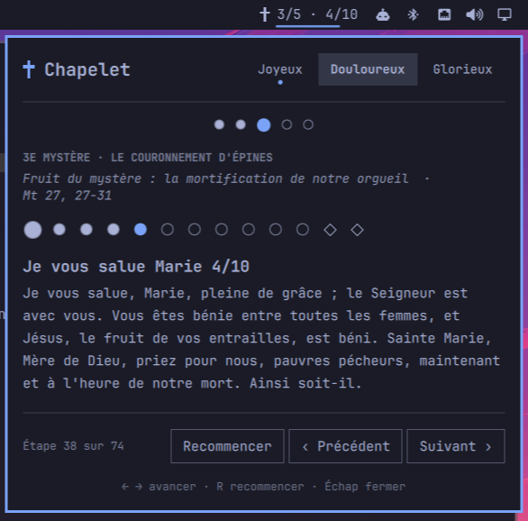

# Rosary for Omarchy

A bar widget for [Omarchy](https://omarchy.org/) that guides you through the traditional rosary
(fifteen mysteries).



- The mysteries of the day are picked automatically (joyful on Monday and Thursday, sorrowful on Tuesday and
  Friday, glorious on Wednesday, Saturday and Sunday), and can be changed by hand.
- Shows the beads of the current decade, the text of each prayer, and the title, fruit and Scripture
  reference of each mystery.
- Progress is saved: you pick up where you left off.

Prayer texts are available in French (`fr`), Latin (`la`) and English (`en`, traditional form).

## Installation

```bash
omarchy plugin add https://github.com/creal73/omarchy-rosary.git --enable
```

## Usage

| Action | Effect |
|---|---|
| Left click on ✝ | Open / close the panel |
| Middle click on ✝ | Start the rosary over |
| `→` `↓` `Space` `Enter` | Next prayer |
| `←` `↑` | Previous prayer |
| `R` | Start over |
| `S` or the ⚙ icon | Open / leave the settings page |
| `Esc` | Close (leaves the settings page first) |
| Click on a bead or a decade | Jump to it |

To bind a key, add this command in `~/.config/hypr/bindings.lua`:
`omarchy-shell shell toggle io.github.creal73.rosary '{}'`.

## Settings

Click the ⚙ icon in the panel header (or press `S`) to open the settings page. Use `↑` `↓` to pick a
row, `Space` to change it (it opens the language list on the first row) and `←` `→` to switch
languages directly. Choices are saved to the widget's entry in
`~/.config/omarchy/shell.json`.

| Key | Default | Purpose |
|---|---|---|
| `language` | `"fr"` | Language of the texts: `fr`, `la` or `en` |
| `showProgress` | `true` | Show "3/5 · 7/10" next to the cross |
| `showFruit` | `true` | Show the fruit of the mystery |
| `showReference` | `true` | Show the Scripture reference |

They can also be changed from a terminal with `omarchy bar set`; the widget updates right away:

```bash
omarchy bar set io.github.creal73.rosary language la              # Latin
omarchy bar set io.github.creal73.rosary language fr              # French
omarchy bar set io.github.creal73.rosary language en              # English
omarchy bar set io.github.creal73.rosary showProgress false --json
```

Or edit the widget's entry in `~/.config/omarchy/shell.json`:

```json
{ "id": "io.github.creal73.rosary", "language": "la" }
```

An unknown language code falls back to French.

State is stored in `~/.local/state/omarchy/rosary.json`.

## Adding a language

1. Copy `i18n/fr.js` to `i18n/<code>.js` and translate the values (keep the keys).
2. Register it in `i18n/I18n.js` (one `.import` line and one entry in `LOCALES`).
3. `node test/rosary-test.js` checks the structure.

## Development

The code lives in `~/.config/omarchy/plugins/io.github.creal73.rosary/`, and the shell reloads the plugin on
every save. Hot reload does not always pick up indirectly loaded files (`Panel.qml`, `Cross.qml`, `i18n/*.js`):
if a change does not show up, run `omarchy restart shell`. Do not put symlinks inside the plugin folder
(`omarchy plugin validate` rejects them).

## License

MIT
